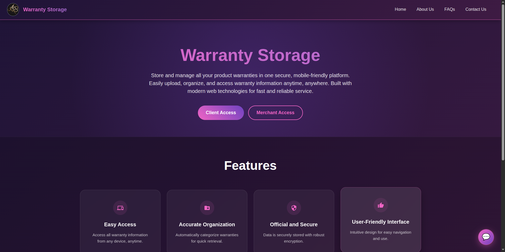
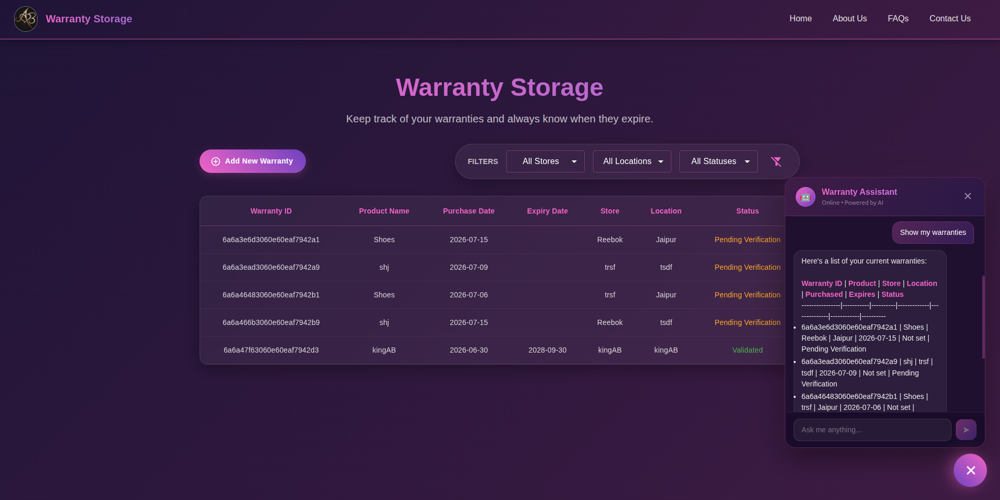
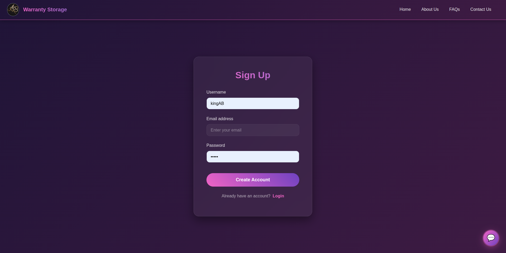
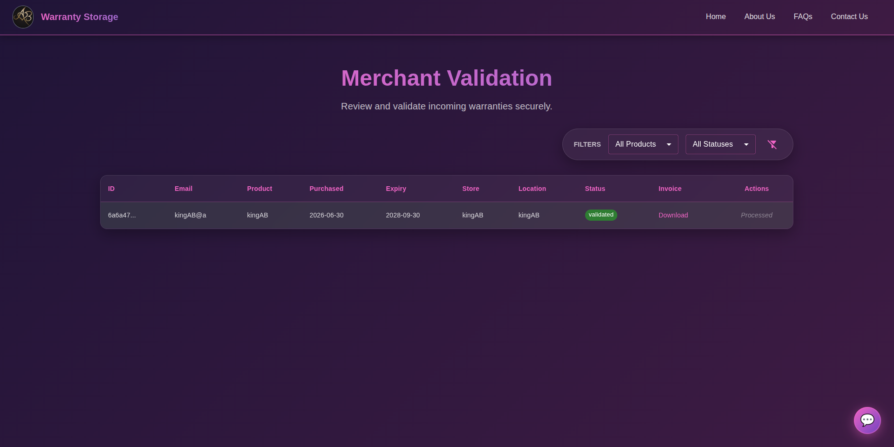

<div align="center">
  
  
  
  
  
  
  
  <br />
  <br />
  
  

  <h1>🛡️ Warranty Storage Platform</h1>
  
  <p>
    <strong>A next-generation management platform empowering merchants and customers to seamlessly secure, manage, and verify warranty data.</strong>
  </p>

  <p>
    <a href="https://warranty-storage-wh5d.vercel.app/"><b>🚀 Live Demo</b></a> • 
    <a href="#-tech-stack"><b>🛠️ Tech Stack</b></a> • 
    <a href="#-quick-start"><b>⚡ Quick Start</b></a> • 
    <a href="#-features"><b>✨ Features</b></a>
  </p>
</div>

---

## 🌟 Overview

**Warranty Storage** is a comprehensive, full-stack **MERN** application architected for the modern web. It redefines warranty tracking with an uncompromising approach to security, user experience, and intelligent automation. 

Featuring a premium **glassmorphism user interface**, **OTP-powered authentication**, and an advanced **Context-Aware AI Chatbot (RAG)**, it transforms static warranty data into an interactive, highly reliable hub for both businesses and consumers.

<br/>

## 📸 Showcase

<table align="center" style="border: none; border-collapse: collapse;">
  <tr>
    <td align="center">
      <b>Interactive Dashboard</b><br/>
      
    </td>
    <td align="center">
      <b>AI Chatbot Assistant</b><br/>
      
    </td>
  </tr>
  <tr>
    <td align="center">
      <b>Glassmorphism Login</b><br/>
      
    </td>
    <td align="center">
      <b>Merchant Portal</b><br/>
      
    </td>
  </tr>
</table>

<br/>

## ✨ Core Features

### 🤖 **Context-Aware AI Chatbot (RAG)**
> *Real-time intelligent assistance powered by `llama-3.1-8b-instant`*
* **Live Context Injection**: Answers dynamically adapt based on real-time database queries & active user role.
* **Seamless Streaming**: Enjoy a buttery-smooth typewriter effect via HTTP Server-Sent Events (SSE).
* **Bulletproof Connectivity**: Built on low-level HTTPS tunneling to bypass WAF / Cloudflare packet drops for 100% LLM uptime.

### 🔐 **Bank-Grade Authentication**
> *Role-based scopes with rigorous session management*
* **Segregated Roles**: Explicit workflows & zero data-leakage between Merchants and Clients.
* **Cryptographic Security**: Hashed passwords (`bcryptjs`) & JSON Web Tokens (JWT).
* **OTP Reset**: NodeMailer powered one-time-passcode pipelines for seamless account recovery.

### 📊 **Advanced Warranty Management**
> *Everything you need, right where you need it*
* **Real-time Filtering**: Hyper-fast, multi-column search by Store, Location, and Status.
* **Instant Issuance**: Merchants can generate and bind warranties to customers in seconds.
* **Frictionless Verification**: Customers securely submit credentials to check real-time warranty validity.

<br/>

## 🛠️ Tech Stack

<div align="center">
  <table>
    <tr>
      <th>Frontend UI & UX</th>
      <th>Backend & Database</th>
      <th>AI & Integrations</th>
    </tr>
    <tr>
      <td valign="top">
        <ul>
          <li><b>React.js</b> (React Router v6)</li>
          <li>Vanilla <b>CSS3</b> Glassmorphism</li>
          <li><b>Bootstrap</b> Components</li>
          <li>React Markdown & Rehype</li>
        </ul>
      </td>
      <td valign="top">
        <ul>
          <li><b>Node.js</b> & <b>Express.js</b></li>
          <li><b>MongoDB</b> & Mongoose</li>
          <li>Native HTTPS Streaming</li>
        </ul>
      </td>
      <td valign="top">
        <ul>
          <li><b>Groq API</b> (Llama 3.1)</li>
          <li><b>Bcrypt.js</b> & JWT</li>
          <li><b>Nodemailer</b></li>
        </ul>
      </td>
    </tr>
  </table>
</div>

<br/>

## ⚡ Quick Start

Follow these steps to spin up the environment locally.

### 1️⃣ Prerequisites
- **Node.js** (v16+)
- **MongoDB** (Atlas or local instance)
- **Groq API Key** (Get it [here](https://console.groq.com/))

### 2️⃣ Installation & Setup

```bash
# Clone the repository
git clone https://github.com/KingAB2004/WarrantyStorage.git

# Navigate into the project directory
cd WarrantyStorage
```

#### **Configure Environment Variables**

Create a `.env` file within the `backend/` directory:

```env
PORT=5000
URI=<your-mongo-connection-string>
JWT_SECRET=<your-super-secret-key>
EMAIL=<your-gmail-address>
PASSWORD=<your-gmail-app-password>
Api_key=<your-groq-api-key>
```

#### **Install Dependencies**
```bash
# Install Backend Libraries
cd backend && npm install

# Install Frontend Libraries
cd ../frontend && npm install
```

### 3️⃣ Running the App

Open two separate terminal instances:

<details open>
<summary><b>🟢 Terminal 1: Backend Server</b></summary>

```bash
cd backend
npm run dev
```
*API runs locally on `http://localhost:5000`*
</details>

<details open>
<summary><b>🔵 Terminal 2: Frontend Client</b></summary>

```bash
cd frontend
npm start
```
*React app starts at `http://localhost:3000`*
</details>

> **Note**: For local testing, ensure any frontend API calls use base URLs pointing to `http://localhost:5000` instead of the production Vercel endpoints.

<br/>

## 🚀 Future Roadmap

- [ ] **Vector Database Migration:** Scale RAG capabilities with Chroma/Pinecone.
- [ ] **Web Push Notifications:** Real-time push alerts for expiring warranties & OTPs.
- [ ] **S3 Document Storage:** Cloud-hosted PDF receipts and warranty policy uploads.
- [ ] **Merchant Analytics:** Graph-based data visualization for granular insights.

<br/>

## 🤝 Contributing

We welcome community contributions! Please follow the steps below:

1. **Fork** the repository and clone it locally.
2. Create a new feature branch: `git checkout -b feature/awesome-addition`
3. Commit your changes: `git commit -m "Add amazing feature"`
4. Push to the branch: `git push origin feature/awesome-addition`
5. Submit a **Pull Request** for review.

<br/>

## ⚖️ License

Distributed under the MIT License. See `LICENSE` for more information.

---
<div align="center">
  <p>💡 <i>Built with passion to elevate the warranty management experience.</i></p>
  <a href="https://github.com/KingAB2004/WarrantyStorage/stargazers"></a>
</div>
