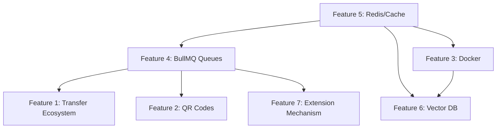

# 🛡️ WarrantyStorage — 7-Feature Expansion Plan

## Current Architecture Snapshot

Before diving in, here's what we're working with:

| Layer | Stack | Deployment |
|---|---|---|
| Frontend | React 18, MUI, Bootstrap, Vanilla CSS (Glassmorphism) | Vercel (free) |
| Backend | Express.js, Mongoose, SendGrid, Groq LLM (llama-3.1) | Render (free) |
| Database | MongoDB Atlas | Atlas (free M0 cluster) |
| Auth | bcrypt + JWT (1h expiry) | In-memory OTP store |

**Code style conventions observed**: minimal comments, no semicolons in some files (inconsistent — we'll match per-file), `const` function assignments, `require/module.exports` (CommonJS), `asyncWrapper` middleware for error catching, `localStorage` for client-side session state, hardcoded production URLs in frontend.

---

## User Review Required

> [!IMPORTANT]
> **Infrastructure decisions that affect cost & deployment:**
> 1. Features 3-5 (Docker, Message Queues, Caching) require **Redis** and optionally **RabbitMQ**. We will use **BullMQ** (Redis-based queues) instead of RabbitMQ to consolidate both caching + queuing into a single Redis instance. This means you only need **one extra service** (Redis) instead of two.
> 2. Feature 6 (Vector DB) uses **ChromaDB** running as a sidecar container — completely free and self-hosted. No Pinecone bill.
> 3. The QR code feature uses `qrcode` npm package — generates QR images server-side as base64, stored in MongoDB alongside the warranty. **No third-party API required.**
> 4. Warranty Extension uses a **simulated payment flow** (no real payment gateway integrated). The merchant pre-defines extension tiers and the client selects a tier. We track the "payment" as a record. When you're ready for real payments (Razorpay/Stripe), we can plug that in later.

> [!WARNING]
> **Breaking change**: The `warrantySchema` in `schema.js` will gain 7 new fields. Existing documents in production MongoDB will NOT break (Mongoose handles missing fields gracefully with defaults), but new queries involving these fields will return `null/undefined` for old records. We will add a one-time migration script to backfill existing docs.

---

## Setup Requirements & Free Deployment Analysis

### What You Need to Set Up

| Requirement | Purpose | Free Tier? | How to Set Up |
|---|---|---|---|
| **Redis** (Upstash/Redis Cloud) | Caching + BullMQ jobs | ✅ Upstash: 10K commands/day free. Redis Cloud: 30MB free | Sign up at [upstash.com](https://upstash.com), create a Redis database, get `REDIS_URL` |
| **Docker + Docker Compose** | Local dev & containerization | ✅ Completely free | Install Docker Desktop or `docker.io` on Linux |
| **GitHub Actions** | CI/CD pipeline | ✅ 2000 min/month free for public repos | Already available via your GitHub repo |
| **ChromaDB** | Vector DB for RAG | ✅ Self-hosted, free | Runs as a Docker container alongside your backend |
| **`qrcode` npm package** | QR generation | ✅ Free, MIT license | `npm install qrcode` |
| **`bullmq` npm package** | Job queuing | ✅ Free, MIT license | `npm install bullmq` |
| **`ioredis` npm package** | Redis client | ✅ Free, MIT license | `npm install ioredis` |
| **`chromadb` npm package** | ChromaDB client | ✅ Free, Apache 2.0 | `npm install chromadb` |
| **`uuid` npm package** | Unique transfer tokens | ✅ Free, MIT license | `npm install uuid` |

### New `.env` Variables Required

```env
# --- Existing (unchanged) ---
URI=<your-mongo-uri>
Email=<your-email>
SENDGRID_API_KEY=<your-key>
JWT_SECRET=<your-secret>
Api_key=<your-groq-key>

# --- NEW ---
REDIS_URL=redis://default:<password>@<host>:<port>
CHROMA_URL=http://localhost:8000
FRONTEND_URL=https://warranty-storage-wh5d.vercel.app
```

### Can This Still Be Freely Deployed?

**Yes.** Here's the deployment topology:

| Service | Platform | Free Tier |
|---|---|---|
| Frontend (React) | Vercel | ✅ Unlimited |
| Backend (Express) | Render | ✅ Free (spins down after 15 min inactivity) |
| MongoDB | Atlas M0 | ✅ 512 MB free |
| Redis | Upstash | ✅ 10K commands/day |
| ChromaDB | Render (Docker) or HuggingFace Spaces | ✅ Free |
| CI/CD | GitHub Actions | ✅ 2000 min/month |

> [!NOTE]
> For **production** use at scale, you'd upgrade Render to the $7/mo Starter plan (always-on), upgrade Upstash to Pro ($10/mo), and host ChromaDB on a VPS. But for your current project scope and demo purposes, **everything is free**.

---

## Proposed Changes

### Feature 1: Warranty Transfer Ecosystem

**How it works**: A logged-in client selects a warranty from their dashboard, clicks "Transfer", enters the recipient's email. The system generates a secure time-limited transfer token, sends an email to the recipient with a one-click accept link. When the recipient (who must have an account) clicks accept, the warranty's `email` field is atomically updated to their email.

---

#### [MODIFY] [schema.js](file:///home/arpit/Desktop/kingAB/coding/WarrantyStorage/backend/models/schema.js)

Add a new `TransferRequest` schema and extend `warrantySchema` with a `transfer_locked` field:

```js
// Add to warrantySchema (after status field, line ~87)
transfer_locked:{
    type:Boolean,
    default:false,
},

// New schema — append before module.exports
const transferSchema = mongoose.Schema({
    warranty_id:{
        type:mongoose.Schema.Types.ObjectId,
        ref:'UserWarranty',
        required:true,
    },
    from_email:{
        type:String,
        required:true,
        trim:true,
    },
    to_email:{
        type:String,
        required:true,
        trim:true,
    },
    token:{
        type:String,
        required:true,
        unique:true,
    },
    status:{
        type:String,
        enum:['pending','accepted','expired','cancelled'],
        default:'pending',
    },
    expires_at:{
        type:Date,
        required:true,
    },
    created_at:{
        type:Date,
        default:Date.now,
    },
})
```

Export: `TransferRequest: mongoose.model('TransferRequest', transferSchema)`

---

#### [NEW] [backend/controllers/transferController.js](file:///home/arpit/Desktop/kingAB/coding/WarrantyStorage/backend/controllers/transferController.js)

Three endpoint handlers:

1. **`initiateTransfer`** — `POST /warranty/setup/transfer/initiate`
   - Validates: warranty exists, belongs to sender, status is `validated`, not `transfer_locked`
   - Sets `transfer_locked: true` on the warranty
   - Generates UUID token with 48h TTL
   - Creates `TransferRequest` document
   - Queues email via BullMQ (Feature 4) to recipient with accept link: `${FRONTEND_URL}/transfer/accept?token=<uuid>`

2. **`acceptTransfer`** — `POST /warranty/setup/transfer/accept`
   - Validates: token exists, not expired, recipient account exists
   - Atomically updates `UserWarranty.email` to `to_email`
   - Sets `transfer_locked: false`, `TransferRequest.status: 'accepted'`
   - Queues confirmation emails to both parties

3. **`cancelTransfer`** — `POST /warranty/setup/transfer/cancel`
   - Only the `from_email` user can cancel
   - Sets `transfer_locked: false`, `TransferRequest.status: 'cancelled'`

---

#### [NEW] [frontend/src/TransferWarranty.js](file:///home/arpit/Desktop/kingAB/coding/WarrantyStorage/frontend/src/TransferWarranty.js)

A new page at route `/transfer/accept` that:
- Reads `?token=` from URL params
- Calls `POST /transfer/accept` with the token + logged-in user's email
- Shows success/error in the existing glassmorphism dialog style

---

#### [MODIFY] [warranty-edit.js](file:///home/arpit/Desktop/kingAB/coding/WarrantyStorage/frontend/src/warranty-edit.js)

- Add a "Transfer" icon button on each validated warranty row
- Opens a dialog asking for recipient email
- Calls `POST /transfer/initiate`
- Shows snackbar confirmation

---

#### [MODIFY] [routes.js](file:///home/arpit/Desktop/kingAB/coding/WarrantyStorage/backend/routes/routes.js)

Add three new routes:
```js
const { initiateTransfer, acceptTransfer, cancelTransfer } = require('../controllers/transferController')
router.route('/transfer/initiate').post(initiateTransfer)
router.route('/transfer/accept').post(acceptTransfer)
router.route('/transfer/cancel').post(cancelTransfer)
```

---

#### [MODIFY] [App.js](file:///home/arpit/Desktop/kingAB/coding/WarrantyStorage/frontend/src/App.js)

Add route: `<Route path="/transfer/accept" element={<TransferWarranty/>} />`

---

### Feature 2: QR Code Integration

**How it works**: When a merchant **approves** a warranty (clicks Approve in MerchantValidation), the backend generates a QR code containing a URL like `${FRONTEND_URL}/verify?id=<warranty_id>`. The QR image is stored as base64 in MongoDB on the warranty doc. Clients can view/download the QR from their dashboard. Anyone scanning the QR sees a public verification page showing warranty status (without needing to log in).

---

#### [MODIFY] [schema.js](file:///home/arpit/Desktop/kingAB/coding/WarrantyStorage/backend/models/schema.js)

Add to `warrantySchema`:
```js
qr_code:{
    type:String,
    default:'',
},
```

---

#### [MODIFY] [backend/controllers/functions.js](file:///home/arpit/Desktop/kingAB/coding/WarrantyStorage/backend/controllers/functions.js)

In `updatewarrantystatus` function (line ~266):
- After updating status to `validated`, generate QR using `qrcode.toDataURL(verifyURL)` 
- Save the base64 string to `UserWarranty.qr_code`
- The verify URL: `${process.env.FRONTEND_URL}/verify?id=${id}`

Add a new handler:
```js
const verifyWarrantyPublic = async (req, res) => {
    const { id } = req.params
    const warranty = await UserWarranty.findById(id).select('-invoice')
    if (!warranty) return res.status(404).json({ msg: 'Not found' })
    res.status(200).json({
        product_name: warranty.product_name,
        store_name: warranty.store_name,
        store_location: warranty.store_location,
        purchase_date: warranty.purchase_date,
        expiry_date: warranty.expiry_date,
        status: warranty.status,
    })
}
```

---

#### [NEW] [frontend/src/VerifyWarranty.js](file:///home/arpit/Desktop/kingAB/coding/WarrantyStorage/frontend/src/VerifyWarranty.js)

Public page at `/verify?id=<id>`:
- Calls `GET /warranty/setup/verify/<id>`
- Shows a clean glassmorphism card with product details, status badge (green/red/orange), store info
- No login required — this is the landing page from QR scans
- Displays a ✅ or ❌ status prominently

---

#### [MODIFY] [warranty-edit.js](file:///home/arpit/Desktop/kingAB/coding/WarrantyStorage/frontend/src/warranty-edit.js)

- Add a "QR" column in the warranty table
- For validated warranties with `qr_code`, show a clickable thumbnail that opens a dialog showing the full QR + download button
- Uses `` since it's stored as `data:image/png;base64,...`

---

#### [MODIFY] [routes.js](file:///home/arpit/Desktop/kingAB/coding/WarrantyStorage/backend/routes/routes.js)

```js
router.route('/verify/:id').get(verifyWarrantyPublic)
```

#### [MODIFY] [App.js](file:///home/arpit/Desktop/kingAB/coding/WarrantyStorage/frontend/src/App.js)

```js
<Route path="/verify" element={<VerifyWarranty/>} />
```

---

### Feature 3: Docker Containerization & CI/CD

**How it works**: We containerize the backend, frontend build, Redis, and ChromaDB into a `docker-compose.yml`. GitHub Actions runs lint + build checks on every push and deploys to Render on merge to `main`.

---

#### [NEW] [backend/Dockerfile](file:///home/arpit/Desktop/kingAB/coding/WarrantyStorage/backend/Dockerfile)

```dockerfile
FROM node:18-alpine
WORKDIR /app
COPY package*.json ./
RUN npm ci --omit=dev
COPY . .
EXPOSE 5000
CMD ["node", "app.js"]
```

#### [NEW] [frontend/Dockerfile](file:///home/arpit/Desktop/kingAB/coding/WarrantyStorage/frontend/Dockerfile)

```dockerfile
FROM node:18-alpine AS build
WORKDIR /app
COPY package*.json ./
RUN npm ci
COPY . .
RUN npm run build

FROM nginx:alpine
COPY --from=build /app/build /usr/share/nginx/html
COPY nginx.conf /etc/nginx/conf.d/default.conf
EXPOSE 80
```

#### [NEW] [frontend/nginx.conf](file:///home/arpit/Desktop/kingAB/coding/WarrantyStorage/frontend/nginx.conf)

SPA fallback config for React Router:
```nginx
server {
    listen 80;
    location / {
        root /usr/share/nginx/html;
        try_files $uri $uri/ /index.html;
    }
}
```

#### [NEW] [docker-compose.yml](file:///home/arpit/Desktop/kingAB/coding/WarrantyStorage/docker-compose.yml)

```yaml
version: '3.8'
services:
  backend:
    build: ./backend
    ports:
      - "5000:5000"
    env_file: ./backend/.env
    depends_on:
      - redis
      - chroma
  frontend:
    build: ./frontend
    ports:
      - "3000:80"
  redis:
    image: redis:7-alpine
    ports:
      - "6379:6379"
  chroma:
    image: chromadb/chroma:latest
    ports:
      - "8000:8000"
    volumes:
      - chroma_data:/chroma/chroma
volumes:
  chroma_data:
```

#### [NEW] [.github/workflows/ci.yml](file:///home/arpit/Desktop/kingAB/coding/WarrantyStorage/.github/workflows/ci.yml)

GitHub Actions workflow:
1. On push/PR to `main`: install deps → build frontend → build backend (lint check)
2. On merge to `main`: trigger Render deploy hook (Render provides a deploy webhook URL)

#### [NEW] [.dockerignore](file:///home/arpit/Desktop/kingAB/coding/WarrantyStorage/backend/.dockerignore)

```
node_modules
.env
.git
```

---

### Feature 4: Message Queues (BullMQ over Redis)

**Why BullMQ instead of RabbitMQ**: RabbitMQ requires a separate AMQP broker, its own container, and dedicated management. BullMQ runs directly on Redis — which we already need for Feature 5 (caching). This means **one infrastructure dependency (Redis) instead of two**. BullMQ supports retries, delayed jobs, priority queues, and rate limiting.

**What gets queued**:
1. All email sending (currently blocking the Express event loop)
2. QR code generation (CPU-bound image encoding)
3. Transfer notification emails

---

#### [NEW] [backend/queues/emailQueue.js](file:///home/arpit/Desktop/kingAB/coding/WarrantyStorage/backend/queues/emailQueue.js)

```js
const { Queue } = require('bullmq')
const IORedis = require('ioredis')

const connection = new IORedis(process.env.REDIS_URL, { maxRetriesPerRequest: null })
const emailQueue = new Queue('email', { connection })

module.exports = emailQueue
```

#### [NEW] [backend/workers/emailWorker.js](file:///home/arpit/Desktop/kingAB/coding/WarrantyStorage/backend/workers/emailWorker.js)

```js
const { Worker } = require('bullmq')
const IORedis = require('ioredis')
const sgMail = require('@sendgrid/mail')
sgMail.setApiKey(process.env.SENDGRID_API_KEY)

const connection = new IORedis(process.env.REDIS_URL, { maxRetriesPerRequest: null })

const emailWorker = new Worker('email', async (job) => {
    await sgMail.send(job.data)
}, {
    connection,
    concurrency: 5,
    limiter: { max: 10, duration: 1000 },
})
```

- Started once in `app.js` via `require('./workers/emailWorker')`
- All existing `sgMail.send()` calls in `functions.js` are replaced with `emailQueue.add('send', mailData)`
- If mail fails, BullMQ retries 3 times with exponential backoff

---

#### [MODIFY] [backend/controllers/functions.js](file:///home/arpit/Desktop/kingAB/coding/WarrantyStorage/backend/controllers/functions.js)

Replace all direct `sgMail.send(mailData)` calls with:
```js
const emailQueue = require('../queues/emailQueue')
await emailQueue.add('send', mailData, { attempts: 3, backoff: { type: 'exponential', delay: 2000 } })
```

Affected functions: `Contact`, `rejectionmail`, `OTP`

---

### Feature 5: Caching Layer (Redis)

**What gets cached**:
1. **Warranty lists** — `GET /getwarranty` results cached per email with 60s TTL
2. **Merchant verification page** — cached per `store_name + store_location` with 30s TTL  
3. **Public warranty verification** — cached per warranty ID with 120s TTL

**Cache invalidation**: On any write (warranty create, status update, transfer), the relevant cache keys are explicitly deleted.

---

#### [NEW] [backend/cache/redisClient.js](file:///home/arpit/Desktop/kingAB/coding/WarrantyStorage/backend/cache/redisClient.js)

```js
const IORedis = require('ioredis')
const redis = new IORedis(process.env.REDIS_URL)
module.exports = redis
```

#### [NEW] [backend/middleware/cacheMiddleware.js](file:///home/arpit/Desktop/kingAB/coding/WarrantyStorage/backend/middleware/cacheMiddleware.js)

A reusable Express middleware:
```js
const redis = require('../cache/redisClient')

const cacheMiddleware = (keyGenerator, ttl = 60) => {
    return async (req, res, next) => {
        const key = keyGenerator(req)
        const cached = await redis.get(key)
        if (cached) return res.status(200).json(JSON.parse(cached))
        res.originalJson = res.json.bind(res)
        res.json = (data) => {
            redis.setex(key, ttl, JSON.stringify(data))
            return res.originalJson(data)
        }
        next()
    }
}
module.exports = cacheMiddleware
```

#### [MODIFY] [backend/controllers/functions.js](file:///home/arpit/Desktop/kingAB/coding/WarrantyStorage/backend/controllers/functions.js)

Add cache invalidation inside:
- `uploadwarranty` → `redis.del(\`warranties:\${email}\`)`
- `updatewarrantystatus` → `redis.del(\`merchant:\${store_name}:\${store_location}\`)` + `redis.del(\`verify:\${id}\`)`

#### [MODIFY] [backend/routes/routes.js](file:///home/arpit/Desktop/kingAB/coding/WarrantyStorage/backend/routes/routes.js)

Apply cache middleware to read-heavy routes:
```js
const cacheMiddleware = require('../middleware/cacheMiddleware')
router.route('/getwarranty').post(cacheMiddleware((req) => `warranties:${req.body.email}`, 60), getWarranty)
router.route('/merchantverifications').post(cacheMiddleware((req) => `merchant:${req.body.store_name}:${req.body.store_location}`, 30), fetchvalidations)
router.route('/verify/:id').get(cacheMiddleware((req) => `verify:${req.params.id}`, 120), verifyWarrantyPublic)
```

---

### Feature 6: Vector Database Migration (ChromaDB)

**How it works**: Instead of dumping raw JSON warranty data into the LLM's system prompt (current approach), we embed warranty data into ChromaDB vectors. When a chatbot query arrives, we do a **semantic similarity search** against ChromaDB to retrieve only the most relevant warranty records, then inject those as context. This scales to thousands of warranties without blowing up the LLM's context window.

**Why ChromaDB**: Free, self-hosted, runs in Docker, has a simple Node.js client, and supports both embedding and querying with a single API call. No API key or billing required.

---

#### [NEW] [backend/vectordb/chromaClient.js](file:///home/arpit/Desktop/kingAB/coding/WarrantyStorage/backend/vectordb/chromaClient.js)

```js
const { ChromaClient } = require('chromadb')
const chroma = new ChromaClient({ path: process.env.CHROMA_URL || 'http://localhost:8000' })
module.exports = chroma
```

#### [NEW] [backend/vectordb/warrantyEmbedder.js](file:///home/arpit/Desktop/kingAB/coding/WarrantyStorage/backend/vectordb/warrantyEmbedder.js)

Functions:
1. `embedWarranty(warranty)` — Called after warranty creation/update. Converts warranty fields into a descriptive text string, upserts into ChromaDB collection `warranties` with the warranty `_id` as the document ID and the user's email as metadata.
2. `queryWarranties(email, question, nResults=5)` — Queries ChromaDB with the user's question, filtered by `email` metadata, returns top-N relevant warranties.
3. `deleteWarrantyEmbedding(warrantyId)` — Removes a warranty from the vector store (used during transfers).

ChromaDB uses its **default embedding function** (all-MiniLM-L6-v2 hosted internally) so we don't need OpenAI embeddings or any API key.

---

#### [MODIFY] [backend/controllers/chatbotController.js](file:///home/arpit/Desktop/kingAB/coding/WarrantyStorage/backend/controllers/chatbotController.js)

Replace the current approach (lines 57-98) where ALL warranties are fetched via `UserWarranty.find()` and dumped as JSON. Instead:

```js
const { queryWarranties } = require('../vectordb/warrantyEmbedder')

// Inside chatHandler, replace the UserWarranty.find() block:
if (email && !isMerchant) {
    const relevantWarranties = await queryWarranties(email, message, 5)
    if (relevantWarranties.length > 0) {
        warrantyContext = `\n\nRELEVANT WARRANTY DATA (for ${email}):\n${JSON.stringify(relevantWarranties, null, 2)}\n\nToday's date is ${new Date().toISOString().split('T')[0]}.`
    }
}
```

This means the LLM only sees 5 most-relevant warranties instead of ALL of them — massively reducing token usage and improving response quality.

#### [MODIFY] [backend/controllers/functions.js](file:///home/arpit/Desktop/kingAB/coding/WarrantyStorage/backend/controllers/functions.js)

In `uploadwarranty` and `updatewarrantystatus`, after the MongoDB write:
```js
const { embedWarranty } = require('../vectordb/warrantyEmbedder')
await embedWarranty(warranty)
```

#### [NEW] [backend/scripts/backfillChroma.js](file:///home/arpit/Desktop/kingAB/coding/WarrantyStorage/backend/scripts/backfillChroma.js)

One-time migration script: reads all existing warranties from MongoDB, embeds them into ChromaDB. Run once after deployment:
```bash
node scripts/backfillChroma.js
```

---

### Feature 7: Warranty Extension Mechanism

**How it works — Full Flow**:

1. **Merchant defines extension plans**: In their Merchant Validation dashboard, a new "Extension Plans" section lets the merchant create pricing tiers. Example:
   | Duration | Price |
   |---|---|
   | 3 months | ₹499 |
   | 6 months | ₹899 |
   | 12 months | ₹1499 |
   
   These plans are stored per-merchant (keyed to `store_name + store_location`).

2. **Client requests extension**: On the client dashboard, validated warranties show an "Extend" button. Clicking it fetches the merchant's extension plans for that store, displays them in a dialog, and the client selects a tier.

3. **Extension request created**: A `pending` extension request is stored in MongoDB. The merchant sees it in their dashboard.

4. **Merchant approves/rejects**: The merchant reviews the extension request. On approval, the warranty's `expiry_date` is extended by the selected duration, and the extension is marked `approved`.

5. **Payment tracking**: Since we're not integrating a real payment gateway, the extension request records the `amount` as a ledger entry. The merchant can see revenue from extensions. When you integrate Razorpay later, the payment confirmation ID gets attached to this record.

---

#### [MODIFY] [schema.js](file:///home/arpit/Desktop/kingAB/coding/WarrantyStorage/backend/models/schema.js)

Two new schemas:

```js
const extensionPlanSchema = mongoose.Schema({
    store_name:{
        type:String,
        required:true,
        trim:true,
    },
    store_location:{
        type:String,
        required:true,
        trim:true,
    },
    plans:[{
        duration_months:{
            type:Number,
            required:true,
        },
        label:{
            type:String,
            required:true,
        },
        price:{
            type:Number,
            required:true,
        },
    }],
    created_at:{
        type:Date,
        default:Date.now,
    },
})

const extensionRequestSchema = mongoose.Schema({
    warranty_id:{
        type:mongoose.Schema.Types.ObjectId,
        ref:'UserWarranty',
        required:true,
    },
    client_email:{
        type:String,
        required:true,
        trim:true,
    },
    store_name:{
        type:String,
        required:true,
    },
    store_location:{
        type:String,
        required:true,
    },
    selected_plan:{
        duration_months:{
            type:Number,
            required:true,
        },
        label:{
            type:String,
            required:true,
        },
        price:{
            type:Number,
            required:true,
        },
    },
    status:{
        type:String,
        enum:['pending','approved','rejected'],
        default:'pending',
    },
    merchant_note:{
        type:String,
        default:'',
    },
    created_at:{
        type:Date,
        default:Date.now,
    },
})
```

Export: `ExtensionPlan: mongoose.model('ExtensionPlan', extensionPlanSchema)`, `ExtensionRequest: mongoose.model('ExtensionRequest', extensionRequestSchema)`

---

#### [NEW] [backend/controllers/extensionController.js](file:///home/arpit/Desktop/kingAB/coding/WarrantyStorage/backend/controllers/extensionController.js)

Five handlers:

1. **`setExtensionPlans`** — `POST /warranty/setup/extension/plans`
   - Merchant creates/updates their extension pricing tiers
   - Upserts `ExtensionPlan` document keyed to `store_name + store_location`

2. **`getExtensionPlans`** — `POST /warranty/setup/extension/plans/get`
   - Client fetches available plans for a given `store_name + store_location`

3. **`requestExtension`** — `POST /warranty/setup/extension/request`
   - Client selects a plan, creates an `ExtensionRequest` in `pending` status
   - Queues email notification to merchant

4. **`getExtensionRequests`** — `POST /warranty/setup/extension/requests`
   - Merchant fetches all extension requests for their store

5. **`handleExtensionRequest`** — `PATCH /warranty/setup/extension/requests/:id`
   - Merchant approves or rejects
   - On approval: calculates new `expiry_date` by adding `duration_months` to current expiry, updates the warranty, queues confirmation email to client
   - On rejection: queues rejection email with merchant's note

---

#### [NEW] [frontend/src/ExtensionPlans.js](file:///home/arpit/Desktop/kingAB/coding/WarrantyStorage/frontend/src/ExtensionPlans.js)

A dialog/section within the MerchantValidation page where the merchant can:
- View their current extension tiers in a table
- Add new tiers (duration in months, label, price in ₹)
- Delete existing tiers
- Save changes via `POST /extension/plans`

Uses the existing `dashboard-dialog-glass`, `textFieldStyles`, and `dashboard-btn-add` CSS classes.

---

#### [MODIFY] [warranty-edit.js](file:///home/arpit/Desktop/kingAB/coding/WarrantyStorage/frontend/src/warranty-edit.js)

- Add an "Extend" button on each validated warranty row (only for non-expired warranties)
- Clicking opens a dialog that:
  1. Fetches `GET /extension/plans` for that store
  2. Displays available tiers as selectable cards (duration, price)
  3. Client selects a tier and confirms
  4. Calls `POST /extension/request`
  5. Shows success snackbar

---

#### [MODIFY] [MerchantValidation.js](file:///home/arpit/Desktop/kingAB/coding/WarrantyStorage/frontend/src/MerchantValidation.js)

- Add a "Manage Extension Plans" button at the top → opens `ExtensionPlans` dialog
- Add an "Extension Requests" tab/section below the main table
- Shows pending extension requests with Approve/Reject buttons
- Approve dialog asks for optional merchant note
- Uses existing glassmorphism styling

---

#### [MODIFY] [routes.js](file:///home/arpit/Desktop/kingAB/coding/WarrantyStorage/backend/routes/routes.js)

```js
const { setExtensionPlans, getExtensionPlans, requestExtension, getExtensionRequests, handleExtensionRequest } = require('../controllers/extensionController')
router.route('/extension/plans').post(setExtensionPlans)
router.route('/extension/plans/get').post(getExtensionPlans)
router.route('/extension/request').post(requestExtension)
router.route('/extension/requests').post(getExtensionRequests)
router.route('/extension/requests/:id').patch(handleExtensionRequest)
```

---

## Complete File Change Summary

### New Files (14 files)

| File | Purpose |
|---|---|
| `backend/controllers/transferController.js` | Warranty transfer initiate/accept/cancel |
| `backend/controllers/extensionController.js` | Extension plans CRUD + request handling |
| `backend/queues/emailQueue.js` | BullMQ email queue definition |
| `backend/workers/emailWorker.js` | BullMQ email worker process |
| `backend/cache/redisClient.js` | Redis client singleton |
| `backend/middleware/cacheMiddleware.js` | Reusable cache middleware |
| `backend/vectordb/chromaClient.js` | ChromaDB client singleton |
| `backend/vectordb/warrantyEmbedder.js` | Warranty embedding/query functions |
| `backend/scripts/backfillChroma.js` | One-time vector DB migration |
| `backend/Dockerfile` | Backend container |
| `frontend/Dockerfile` | Frontend container (multi-stage) |
| `frontend/nginx.conf` | SPA routing for Nginx |
| `docker-compose.yml` | Full-stack orchestration |
| `.github/workflows/ci.yml` | CI/CD pipeline |
| `frontend/src/VerifyWarranty.js` | Public QR verification page |
| `frontend/src/TransferWarranty.js` | Transfer acceptance page |
| `frontend/src/ExtensionPlans.js` | Merchant extension tier manager |

### Modified Files (7 files)

| File | Changes |
|---|---|
| `backend/models/schema.js` | 3 new schemas + 2 new fields on `warrantySchema` |
| `backend/controllers/functions.js` | Email → queue, QR gen, cache invalidation, vector embedding |
| `backend/controllers/chatbotController.js` | Replace full-fetch with vector search |
| `backend/routes/routes.js` | ~12 new route definitions |
| `backend/app.js` | Initialize worker, Redis connect log |
| `frontend/src/App.js` | 3 new routes |
| `frontend/src/warranty-edit.js` | Transfer + QR + Extend buttons, new columns, dialogs |
| `frontend/src/MerchantValidation.js` | Extension plans management, extension requests section |

---

## Execution Order (Dependency Chain)

The features have dependencies — they must be built in this sequence:



**Build order**:
1. **Feature 5** — Redis caching (foundation — everything depends on Redis)
2. **Feature 4** — BullMQ queues (uses Redis, needed by Transfer + Extension emails)
3. **Feature 3** — Docker (containerize what we have so far)
4. **Feature 2** — QR codes (standalone, uses queue for async gen)
5. **Feature 1** — Transfer ecosystem (uses queues for emails)
6. **Feature 7** — Extension mechanism (uses queues for emails)
7. **Feature 6** — Vector DB migration (needs Docker for ChromaDB, touches chatbot last)

---

## Open Questions

> [!IMPORTANT]
> 1. **Currency**: The extension pricing uses `₹` (INR). Should we support multi-currency, or is INR sufficient?
> 2. **Transfer restrictions**: Should a warranty be transferable multiple times, or only once? (Currently allowing multiple transfers.)
> 3. **QR format**: Should the QR code encode just the verification URL, or also include product name + expiry in plain text below the QR image?
> 4. **Rate limiting**: Should we add Redis-based rate limiting on the chatbot endpoint (e.g., 20 requests/minute per email)?

---

## Verification Plan

### Automated Tests
1. **Docker build verification**: `docker-compose up --build` must start all 4 services without errors
2. **API route testing**: Use `curl` / Postman to hit every new endpoint:
   - `POST /transfer/initiate` → returns token
   - `POST /transfer/accept` → warranty email changes
   - `PATCH /merchantverifications/:id` with status `validated` → QR code generated
   - `GET /verify/:id` → returns public warranty data
   - `POST /extension/plans` → merchant creates tiers
   - `POST /extension/request` → client selects tier
   - `PATCH /extension/requests/:id` → expiry date extended
3. **Cache verification**: Hit `/getwarranty` twice — second call should be <5ms (Redis hit)
4. **Queue verification**: Check BullMQ dashboard or logs — emails should process asynchronously
5. **Vector DB verification**: Send chatbot query with `message: "show my iPhone warranty"` — should return only relevant warranty, not all warranties

### Manual Verification
1. **Full transfer flow**: Login as User A → Transfer warranty → Login as User B → Accept → Verify warranty moved
2. **QR scan**: Open phone camera on generated QR → verify it lands on `/verify?id=xxx` page
3. **Extension flow**: Login as merchant → Create 3 tiers → Login as client → Request extension → Login as merchant → Approve → Verify expiry date changed
4. **Browser testing via subagent**: Navigate each new page, verify glassmorphism styling matches existing dashboard aesthetic
